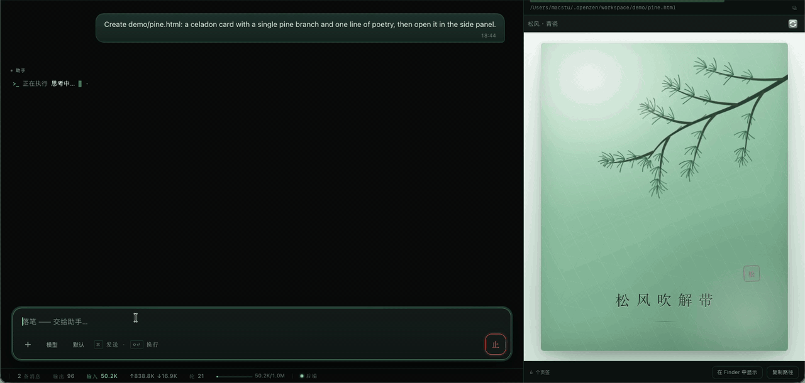
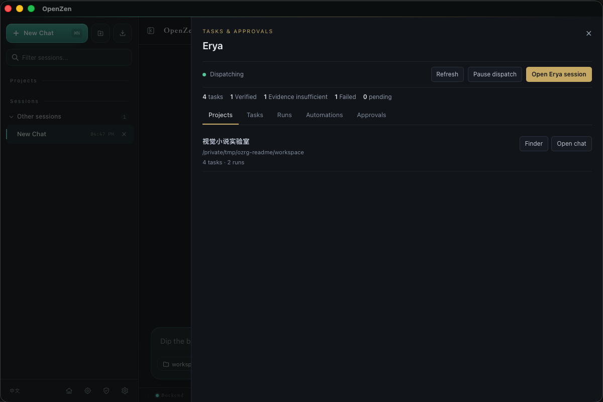
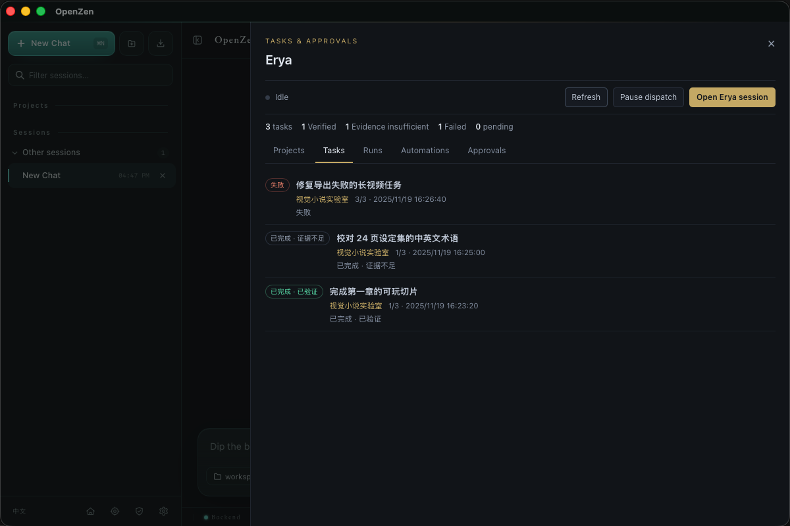
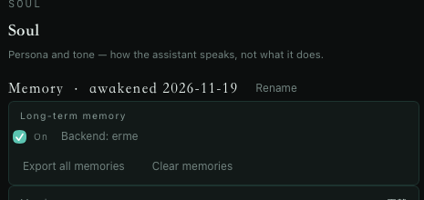

<h1 align="center">OpenZen</h1>

> **A local-first agent harness for work that outlives the chat.**
> One conversation becomes a durable task graph: background workers execute, executable gates verify, and the outcome is remembered — on your Mac, with your models, under your permissions.

[](https://github.com/V1sMu21/OpenZen/releases/latest) [](https://github.com/V1sMu21/OpenZen/actions/workflows/ci.yml)  [](LICENSE)

**English** · [中文](README.zh-CN.md)

<a href="assets/runtime-demo.gif"></a>

*A real desktop run: one prompt → plan → artifact preview → executable verification → delivery note. Click the image to watch the 16-second loop.*

**⬇️ [Download for macOS](https://github.com/V1sMu21/OpenZen/releases/latest)** · [Build from source](#build-from-source) · [Development guide](docs/development-guide.md)

- 🧭 **A control plane, not a chat wrapper.** Erya turns a request into a durable task graph, dispatches bounded background workers, and keeps the console — projects, tasks, runs, automations, approvals — in one place.
- ✅ **"Done" is a verdict, not a claim.** The model cannot mark its own work complete. Executable gates, a blind review, and a diff self-check decide between `verified`, `unverified`, and `failed`.
- 🧠 **Memory that compounds — and knows its scope.** ERME keeps a bounded soul layer, a crash-safe working cache, a vector index, and a budgeted store. Project memory does not leak across projects.
- 🔒 **Local-first, desktop-native.** By default, inference, memory, and files stay on your machine. Bring oMLX on Apple Silicon — or a cloud endpoint when you choose one. No account, no telemetry.
- 🛠 **Engineered for real model output.** Streaming tool calls are repaired, arguments are canonicalized, approval decisions are remembered, and checkpoints survive crashes. We treat model output as untrusted input, because it is.

---

## Contents

- [What OpenZen is](#what-openzen-is)
- [Meet Erya: one conversation, a team behind it](#meet-erya-one-conversation-a-team-behind-it)
- [Done is a verdict](#done-is-a-verdict)
- [Memory that compounds](#memory-that-compounds)
- [Context, tools, and the loop](#context-tools-and-the-loop)
- [Permissions and safety](#permissions-and-safety)
- [The desktop](#the-desktop)
- [Models and local inference](#models-and-local-inference)
- [Architecture](#architecture)
- [Quick start](#quick-start)
- [Extending](#extending)
- [Status and limits](#status-and-limits)
- [Engineering](#engineering)
- [FAQ](#faq)
- [Contributing](#contributing)
- [Prior art](#prior-art)
- [License](#license)

---

## What OpenZen is

Every agent product is two things: a model and a harness. The model predicts tokens. The harness decides what those tokens are allowed to do — which tools exist, what context survives, how work is split, when a result is accepted, what is remembered, and what happens when a tool call arrives malformed.

OpenZen is the second thing: a harness written as one Rust workspace and shipped as a macOS app. It is built around a simple rule:

> **The model proposes. The harness disposes.**

The agent can plan, call tools, run commands, and write code. It cannot declare its own work verified, silently widen its permissions, or forget a project boundary.

The harness has five jobs:

1. **Keep context small and relevant** — a compact base prompt, progressive disclosure for skills, a live state block instead of a growing transcript.
2. **Turn intent into durable state** — a task graph in SQLite, not a plan that lives only in the model's context.
3. **Run work in parallel under explicit permissions** — background jobs, bounded workers, approvals that wait for a human.
4. **Verify with the environment** — executable acceptance gates, not self-report.
5. **Remember what happened** — scoped memory, lessons with evidence, and a run ledger you can query later.

> **Current form:** a macOS Apple Silicon desktop app (Tauri v2 + Svelte 5). The same kernel also runs as a local WebUI server (`openzen serve`) for headless machines and remote use.

---

## Meet Erya: one conversation, a team behind it

**Erya (尔雅)** is the resident agent. The name comes from the oldest surviving Chinese dictionary — a book about making distinctions. Its job here is similar: decide what is done, what is not, and what is worth remembering.

A session can run in two modes:

| Mode | What happens | Best for |
|---|---|---|
| **Conversation** | You and Erya work in the same turn. It plans, reads, edits, and answers directly. | Thinking, small edits, questions, exploratory work |
| **Dispatch** | Erya decomposes the request into a small task graph (≤6 verifiable items), writes it to SQLite, and returns control to you while workers run. | Multi-step work, parallel tasks, anything longer than one turn |

Both modes share the same tools and memory; the model is chosen per session, and per task in dispatch mode. `/erya` — or the **Hand to Erya** button — hands the current request to dispatch mode. There is no second persona.



*The Erya console: one project, its tasks, and the three terminal verdicts side by side. No transcript needed to see what is done, what is unproven, and what failed.*

### The lifecycle

```
you ──▶ Erya ──▶ task graph (SQLite)
                    │
          scheduler │ promotes ready tasks, dispatches workers
                    ▼
              background workers ──▶ files, commands, artifacts
                    │
                    ▼
                 verifier ──▶ verified | unverified | failed
                    │
                    ▼
             run ledger + one digest ──▶ you
```

- **The scheduler is durable.** Tasks, attempts, approvals, and runs live in `butler.db`. A crash loses at most the in-flight attempt; the graph, approvals, and completed runs are still there after a restart.
- **Workers are bounded.** A worker gets its own session, its own working directory, and the task's model policy. It cannot ask you a question; if it needs a decision, it reports back and Erya asks.
- **You get a digest, not a stream of chatter.** One report at the end: what finished, what is unverified, what is blocked, and what happens next.
- **Every attempt is inspectable.** The console keeps the run's model, duration, status, summary, and the child transcript with its tool timeline. "What happened at 14:02?" is a query, not a guess.

Under the graph, the same primitives are available directly: background jobs, subagents, goal mode (one objective, one budget, one acceptance command), and the opt-in steward. Erya orchestrates them; it does not replace them.

### The console

The **Erya** panel is the operations side of the app, with five tabs:

| Tab | What it shows |
|---|---|
| **Projects** | Registered project roots, task/run counts, recent activity, reveal in Finder, "start a conversation here" |
| **Tasks** | The task graph: status, dependencies, attempts, assumptions, project, approval state |
| **Runs** | Every dispatch: model, duration, status, summary, replayable transcript and tool timeline |
| **Automations** | Reminders, goals, steward tickets, platform bridges — one registry instead of four panels |
| **Approvals** | Irreversible actions waiting for a human decision, with impact and reversibility |

### Context stays bounded

A dispatch session does not grow without limit. Each turn carries:

- a **state block** rebuilt from the task graph (counts, active tasks, pending approvals, projects);
- the **last 30 turns** of the conversation;
- a **one-line epoch summary** for older history, with `history_search` available when the model needs the original.

The model sees the current state of the work, not a transcript of everything that ever happened. That is what makes a 7×24 session practical instead of expensive.

---

## Done is a verdict

Most agents end a task when the model says it is done. OpenZen ends it when the environment agrees.

Before work starts, a non-trivial task gets a verification contract. In a normal session it is a `task_spec.md`; in dispatch mode the same fields live on the task in the graph. Either way, it names a deliverable list and executable acceptance commands:

```markdown
# normal-session examples; dispatch verification is stricter (below)
[verify] cargo test --lib
[verify] python3 scripts/check_assets.py --pixels
[verify] python3 scripts/run_sim.py --duration 60
```

If no contract exists, the harness synthesizes a minimal one from the task. In a normal session's `task_spec.md`, the commands use a policy-safe grammar (no pipes, no `&&`, no backticks; relative paths only). A command that policy refuses is **blocked**, not failed — it does not burn the repair budget.

Dispatch mode is stricter. An explicit `[verify]` / `verify` command on the task graph defaults to known test/build runners — `cargo test/check/build`, `npm/pnpm/yarn test/build`, `pytest`, `go test`, `tsc`, `make test`. Custom scripts are refused unless the process is started with `OPENZEN_ALLOW_CUSTOM_VERIFY=1`; shell chaining and redirects are never accepted.

When a task has dependencies and explicit verification commands, dispatch defaults to `strict_deps`: the child waits until every upstream task is `verified`. An `unverified` upstream is not silently consumed; pass `strict_deps: false` only for a deliberate legacy flow. This is what makes a content chain (A → B → C → D) safe: B cannot start on A's unproven output.

### The evidence stack

1. **Hard gates** — the acceptance commands, executed in the task's project root.
2. **Blind review** — a clean-context reviewer sees the spec and the gate evidence, never the worker's own summary. It can name a defect; only a named defect earns another repair round.
3. **Diff self-check** — the final patch is reviewed against the spec, file by file.
4. **Delivery note** — how it was verified and what was left open. The desktop folds it out of the reply body, so copying the answer copies only the answer.

### Terminal states

| State | Meaning | Desktop label |
|---|---|---|
| `verified` | Every hard gate passed, at least one strong gate passed, no review defect, no inconclusive gate. | Completed (verified) |
| `unverified` | The work finished, but the evidence could not prove it. Honest, terminal, never silently upgraded. | Completed (evidence insufficient) |
| `failed` | A hard gate failed. The run is red and the evidence says why. | Failed |

The verifier is the only component allowed to write a terminal status in dispatch mode. Erya can report a verdict; it cannot create one. This is slower than self-report. It is the difference between a demo and a delivery.



*`verified`, `unverified` (evidence insufficient), and `failed` are separate terminal states. The badge is written by the verifier, not by the model.*

---

## Memory that compounds

**ERME** is the in-house memory engine. It is not a vector store bolted onto a chat log; it is a tiered store with a write policy.



*The memory control surface: the long-term store is on, backed by ERME, and exportable/clearable without editing files.*

| Layer | What it holds | Why it exists |
|---|---|---|
| **L0 · soul** | Portrait, life narrative, reflection, idle associations | Continuity across sessions; injected in a bounded prefix, not a dump |
| **L1 · working** | Hot facts and recent state, with a write-ahead log | Crash-safe, nanosecond reads |
| **L2 · vector** | HNSW index plus hybrid lexical/vector recall | Semantic search without leaving the machine |
| **L3 · persistence** | Compressed long-term store with budgets | Bounded growth: daily caps, importance-scored eviction, dedupe, decay |

### Scope, quality, budget

- **Every memory carries a scope** — `project:<id>`, `workspace:<hash>`, or `legacy`. Project recall does not silently fall back to the global pool. A project's memory stays in that project.
- **Writes pass a quality gate.** Low-confidence statements are rejected or quarantined; a bad conjecture never becomes a permanent fact. The soul prefix is capped at a few hundred characters and only high-confidence, readable facts are injected.
- **Secrets are redacted** before storage — API keys, bearer tokens, cloud credentials, private keys.
- **Growth is budgeted.** The store does not grow forever because the assistant is always on.

### The compounding loop

- **Checkpoints** resume a session mid-run after a restart, with git context attached.
- **The harness ledger** records reusable lessons, but only with verifiable evidence and snapshot rollback.
- **Reflections** (`reflections.jsonl`) turn successes and failures into text future sessions can read.
- **Quality failures** become ledger entries that later sessions avoid.

A resident assistant should get better at your work, not just longer. That is the point of memory that is scoped, audited, and bounded.

---

## Context, tools, and the loop

### Context

The base system prompt is **under 4 KB** (3.4 KB Chinese / 3.8 KB English). Skills and SOPs are disclosed progressively; they are searched and loaded when relevant, not pasted into every request. Ordinary sessions compress when they approach the model's context window; dispatch sessions use the state-block/epoch strategy above.

Tool schemas are sorted, the prompt prefix is kept byte-stable, and the tool list is deterministic — so provider-side prompt caches actually hit. With a local model, that is not a billing optimization; it is the difference between a responsive session and a long prefill on every turn.

### Tools

**40+ built-in tools** cover files, shell, search, browser, computer use, scheduling, tasks, and memory. MCP servers add more; skills add playbooks. The important part is not the count:

- **One dispatch boundary.** Every tool call passes through `ToolRegistry::dispatch`, where arguments are canonicalized against the tool's schema. A model that sends `cmd` instead of `code`, or the tool name as the key, still gets its call executed.
- **Parallel where safe.** Independent reads and probes run concurrently; control tools (`ask_user`, `submit_plan`) bypass the queue so they never wait behind a long build.
- **Cancellation propagates.** Stopping the parent stops its children; stopping a child leaves the parent alive.
- **Jobs are first-class.** Long commands and subagents run as tracked jobs with output, status, and a kill switch, instead of blocking the conversation.

### Reliability

Real gateways and local models produce malformed tool calls. OpenZen repairs them at the stream boundary:

- leaked DSML parameters and half-converted tool-call fragments;
- truncated closers (`</` instead of `</parameter>`) and trailing call tags;
- wrong key names, doubly-encoded arguments, and nameless parameters;
- a JSON value that parses cleanly but has swallowed the next parameter.

The regression fixtures are the raw bytes from failing sessions. The parser is not "hoping for the best"; it has tests for the exact shapes that broke real runs.

Long silences are treated as slow, not dead: an idle SSE stream is tolerated for 180 seconds on cloud gateways and 300 seconds on local servers before a retry, because a local model may be thinking. Checkpoints and retries keep long runs alive; a loop breaker stops repeated identical calls. The goal is boring reliability, not a perfect demo.

---

## Permissions and safety

Local does not mean trusted. The model's output is untrusted input, and the safety layer sits at dispatch time, not in the prompt.

| Boundary | Behavior |
|---|---|
| **Workspace** | Writes stay inside the working directory. A write outside it requires an explicit approval, and the approval is remembered for that path in that session. |
| **Shell** | Commands are approved by pattern. "Always trust" remembers a specific command shape, not a blanket "allow everything". |
| **Workers** | A worker's write tools refuse paths outside its project. On macOS, its shell runs under a `sandbox-exec` write-jail: project root, temp, and build caches only. |
| **Irreversible work** | In dispatch mode, tasks are classified as read-only, reversible, or irreversible. Irreversible tasks park in the approval queue instead of proceeding. |
| **Secrets** | Credentials live in your config, not in prompts. Memory redacts common key patterns before storage. |
| **Audit** | Approvals, denials, and tool calls are logged; the run ledger keeps what happened and which model did it. |

**Approvals wait for a human.** The current default is up to 30 minutes, with a countdown, a system notification when you step away, and a watchdog that does not mistake your absence for a bad request. A denial is recorded, so the same question is not asked twice. **Full access** exists for unattended runs — it is a mode you choose, not the default.

**Steward (opt-in).** Every step can be written to a local SQLite flight recorder. Deterministic detectors flag a stalled ticket, a repeated tool call, an out-of-scope write, a budget overrun, or a completion without evidence before any model is asked; the correction engine can nudge the worker or roll back the files a step touched. Supervision stays as local as inference.

---

## The desktop

The desktop is not a terminal with a text box. It is built for the shape of agent work: long, parallel, artifact-heavy.

- **Artifact panel** — HTML, Markdown, images, PDF, Word/Excel/PowerPoint, spreadsheets, code, diffs, and terminal output. Side by side when the window is wide, floating over the conversation when it is not.
- **Streaming timeline** — thinking blocks, tool cards, and changed-file summaries that fold themselves. Long sessions keep a constant DOM instead of growing a scrollback monument.
- **Work in view** — job and subagent strips next to the composer, task chips above it, approval cards with impact and reversibility, and a delivery note that folds away.
- **Erya console** — projects, tasks, runs, automations, approvals; a project card can open a conversation rooted in that project.
- **Settings** — models, providers, skills, MCP servers, soul status, token usage, and updates. The UI is bilingual (Chinese/English).
- **A design language, not a theme** — Song-celadon “artifact grammar”: three colors, glaze-like surfaces, Song serif for structure and Kai calligraphy for thought. The rules live in [frontends/DESIGN.md](frontends/DESIGN.md).

**Other surfaces.** The same kernel also runs as `openzen serve` (local WebUI). WeChat, Feishu, and Telegram bridges let the same assistant answer where you already chat, sharing the same kernel and data root.

---

## Models and local inference

OpenZen is **local-first, not local-only**. It speaks OpenAI-compatible chat completions. You can register any number of named model entries and choose one per session, with per-model reasoning effort.

| Backend | Typical endpoint | Notes |
|---|---|---|
| **oMLX** (reference) | `http://127.0.0.1:8000/v1` | MLX on Apple Silicon; keeps multiple long-context models resident |
| **Cloud API** | your provider | Optional; data goes only to the endpoint you configure |

**Suggested local models.** Practical starting points on oMLX — not endorsements: `qwen3.8-27b`, `qwen3.8-flash-next`, `glm5.3-flash`, `Sage-A1.5`, `Occamy-1.0`. Pick by your memory and context needs.

**Hardware.** Apple Silicon is required for the desktop app. 16 GB is enough for 7–14B models at practical context sizes; 64 GB+ unlocks the long-context models this harness is designed for. A 256 GB unified-memory Mac is the sweet spot, not a requirement.

**Privacy.** Runtime data lives under `~/.openzen/` — workspace, memory, harness ledger, logs, sessions, and the butler database. There is no account and no telemetry. With local models and local tools, it works offline; web search, browser, and cloud models need the network you give them.

---

## Architecture

```
┌─────────────────────────────────────────────────────────────┐
│ macOS app · Tauri v2 + Svelte 5                             │
│  chat · artifact panel · Erya console · approvals · settings│
└───────────────┬─────────────────────────────────────────────┘
                │ Tauri commands / SSE
┌───────────────▼─────────────────────────────────────────────┐
│ oz-core        loop · context · checkpoints · quality gates │
│ oz-tools       40+ tools · MCP · skills · browser           │
│ oz-llm         OpenAI-compatible · streaming               │
│ oz-memory      ERME L0–L3 · scoped recall · budgets         │
│ oz-steward     task graph · verifier · goals · flight log   │
│ oz-safety      approvals · trust store · boundaries         │
└───────────────┬─────────────────────────────────────────────┘
                │
┌───────────────▼─────────────────────────────────────────────┐
│ local model server (oMLX)                                   │
│ or a cloud endpoint you configure                           │
└─────────────────────────────────────────────────────────────┘
```

| Layer | Crates | Responsibility |
|---|---|---|
| **Kernel** | `oz-core`, `oz-core-types` | Agent loop, context and compression, checkpoints, quality gates, jobs, subagents |
| **Models** | `oz-llm` | OpenAI-compatible client, streaming, retries, routing |
| **Tools** | `oz-tools`, `oz-mcp`, `oz-skill-mcp`, `oz-browser` | Tool registry, MCP bridge, skill store, browser and computer use |
| **State** | `oz-memory`, `oz-steward` | ERME memory, task graph, verifier, goals, flight recorder, rollback |
| **Safety** | `oz-safety` | Permission pipeline, trust store, workspace and path boundaries |
| **Surfaces** | `src-tauri`, `frontends`, `oz-server`, `oz-platform-*` | Desktop, WebUI, messaging bridges |
| **Ops** | `oz-config`, `oz-scheduler`, `oz-reflect`, `oz-plugin`, `oz-import`, `oz-tests` | Config, scheduling, reflection, plugins, session import, test harness |

23 `oz-*` crates plus the Tauri shell form one Cargo workspace. The frontend is Svelte 5 with a custom `@theme` token system, not a component kit.

---

## Quick start

### 1. Install the app

Download the latest [dmg](https://github.com/V1sMu21/OpenZen/releases/latest), open it, and drag **OpenZen** into Applications. The build is ad-hoc signed rather than notarized, so macOS may ask you to confirm the first launch (System Settings → Privacy & Security → Open Anyway).

### 2. Bring a model

Start oMLX on Apple Silicon at `http://127.0.0.1:8000/v1`. This is the supported local runtime; a cloud OpenAI-compatible endpoint is optional.

```bash
# sanity check: your server should answer this
# (a 401 asking for a key is also a healthy answer)
curl http://127.0.0.1:8000/v1/models
```

### 3. Point OpenZen at it

Open **Settings → Models**, add a named entry with the endpoint and model id, and set it as default. Credentials are stored locally. The first launch creates `~/.openzen/`.

### 4. Give it real work

Ask for something multi-step — "build a landing page and verify it in the browser", "fix the failing test and show me the diff", "research this market and produce a report". For a long-running job, hand it to Erya and get on with your day; the task graph keeps working while you do something else.

### Build from source

Requirements: macOS with the Command Line Tools (they provide `clang` and the linker; full Xcode is not required), Rust (the pinned toolchain is in `rust-toolchain.toml`), Node.js 20+, and the Tauri v2 CLI.

```bash
git clone https://github.com/V1sMu21/OpenZen.git
cd OpenZen

# once
cargo install tauri-cli --version "^2" --locked

npm --prefix frontends ci
cargo tauri build --bundles app
# → target/release/bundle/macos/OpenZen.app
```

For development:

```bash
cargo tauri dev
# or isolate runtime data from your real install:
OPENZEN_DATA_DIR=/private/tmp/openzen-dev cargo tauri dev
```

### WebUI

```bash
npm --prefix frontends run build
cargo run -- serve --port 18567
```

`OPENZEN_DATA_DIR` moves the whole data root (workspace, memory, sessions, logs) for a dev build. The default is `~/.openzen/`.

---

## Extending

- **Tools.** Implement `ToolHandler` in `oz-tools` and register it in `ToolRegistry`; or expose tools from an MCP server without touching Rust.
- **Skills.** A skill is a `SKILL.md` with frontmatter and a body. Skills are indexed, searched, and loaded on demand — progressive disclosure, not a prompt dump.
- **MCP.** Add stdio MCP servers in Settings; their tools appear in the same registry, with the same approval pipeline.
- **Platforms.** `oz-platform-wechat`, `oz-platform-feishu`, and `oz-platform-telegram` adapt the same kernel to messaging surfaces.
- **UI.** Svelte 5 components and tokens live in `frontends/`; read `frontends/DESIGN.md` before changing the visual language.
- **Docs.** Start with [docs/development-guide.md](docs/development-guide.md), then the design notes under `docs/`.

---

## Status and limits

**Pre-1.0, actively developed.** The latest tagged release is **v0.2.6** (November 2026). The control-plane work described here is on `main` and ships in the next release; build from source if you want it today.

**Working now**

- Erya dispatch mode: task graph, scheduler, background workers, verifier-owned terminal states, digest.
- Project console: projects, tasks, runs, automations, approvals; run transcripts and tool timelines.
- Project-scoped execution: task-level project binding, worker file isolation, macOS shell write-jail.
- ERME: scoped recall, quality-gated writes, bounded soul injection, WAL compaction, dedupe/decay, secret redaction.
- Approvals that wait: 30-minute default, notifications, wall-clock countdown, denial memory.
- Streaming repair: canonical arguments, DSML leak recovery, truncated closers, trailing call tags.
- 1,600+ workspace tests; the ERME crate has its own suite.

**Known limits**

- The desktop is macOS Apple Silicon only. The kernel and server are independent of the desktop shell, but other desktop targets are not supported yet.
- A weak local model produces weak plans. The harness can reject bad work; it cannot invent capability.
- Verification is only as strong as the gates. An explicit `[verify]` command can make a content task `verified`; without strong evidence it ends `unverified` — by design. Custom verification scripts need `OPENZEN_ALLOW_CUSTOM_VERIFY=1`.
- This is not a VM. Approvals and sandboxes reduce risk; they do not make untrusted code safe.
- The desktop is the primary surface. The WebUI is useful for headless machines, but it does not have the console or artifact panel.

---

## Engineering

The project is developed like the harness it ships: gates before claims.

```bash
# backend
cargo test --workspace -- --test-threads=1
cargo clippy --workspace --all-targets

# mechanical gates (event pairings, i18n, undefined CSS vars, defaults, safety boundaries)
bash scripts/verify_gates.sh --base HEAD

# complex scenario suite (release-gate R2.5)
cargo test -p oz-steward --test scenario_suite -- --test-threads=1
cargo test -p oz-steward --test goal_fault_injection -- --test-threads=1
cargo test -p oz-steward --test steward_fault_injection -- --test-threads=1
python3 scripts/scenarios/check.py

# frontend
npm --prefix frontends run check
npm --prefix frontends run build
```

- **Regression tests come from real failures.** Streaming-parser tests replay the raw bytes of malformed gateway responses; checkpoint tests use real session data when available.
- **One fix, one failing test first.** A change that cannot be tested is marked as such and given a manual verification path.
- **Releases are derived.** [Conventional Commits](https://www.conventionalcommits.org/) → `git-cliff` → `scripts/release.sh` → a tag. The release gate runs the suite, builds the dmg on macOS, and attaches it to the GitHub Release.
- **The workspace is checked as a whole.** Per-crate tests are not enough; a change can compile in one crate and break the binary.
- **Complex scenarios are a gate, not a demo.** 34 executable scenarios cover content dependency chains, failure blocking, restart recovery, approvals, concurrency, project boundaries, cancellation, worker timeouts, subagent cancellation and compaction recall. `scripts/scenarios/check.py` is a ratchet: removing a scenario fails the release gate.

---

## FAQ

**Do I need a 256 GB Mac?**
No. 16 GB is enough for 7–14B models at practical context sizes. Unified memory matters for long-context models and for keeping the model, the vector index, and the browser in one pool.

**Can I use a cloud model?**
Yes. Any OpenAI-compatible endpoint can be a named model. Local is the default posture, not a restriction.

**Does my data leave the machine?**
Only to the endpoints you configure — a local model server, a cloud model you add, or a web tool you invoke. There is no account, no telemetry, and no hosted control plane.

**Does it work offline?**
With a local model and local tools, yes. Web search, browser automation, and cloud models need the network you give them.

**How is "done" decided?**
By the verifier, from gate evidence. The model can propose a completion; it cannot write `verified`. If the evidence is inconclusive, the task ends as `unverified`.

**Is there a Linux or Windows desktop build?**
Not today. The Rust kernel and server are not tied to the desktop shell; the desktop shell and its macOS integrations are not supported on other platforms yet.

---

## Contributing

Issues and pull requests are welcome. For a non-trivial change:

1. Read [AGENTS.md](AGENTS.md) and [docs/development-guide.md](docs/development-guide.md).
2. Keep the change scoped. A bug fix should not carry a refactor.
3. Add a regression test that fails before the fix.
4. Run the gates above, including the workspace-wide check.
5. Use a Conventional Commit message (`fix(llm): …`, `feat(butler): …`). Releases are derived from them.

If you change the system prompt, the streaming parser, or a safety boundary, add a test with the exact shape you are protecting. Those are the places where "it works on my machine" is not enough.

If OpenZen earns a place on your Mac, a star helps other people find it.

---

## Prior art

OpenZen began as a Rust rewrite of the Python **GenericAgent** framework and has since diverged completely. It also owes ideas to the wider open-source harness community — system reminders, progressive-disclosure skills, diff self-checks, flight recorders, and the discipline of treating prompts as code. Thank you to the open-source harness community.

---

## License

[MIT](LICENSE) © 2026 OpenZen contributors
