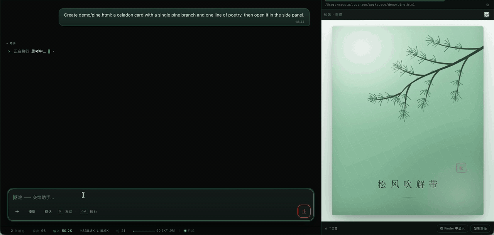
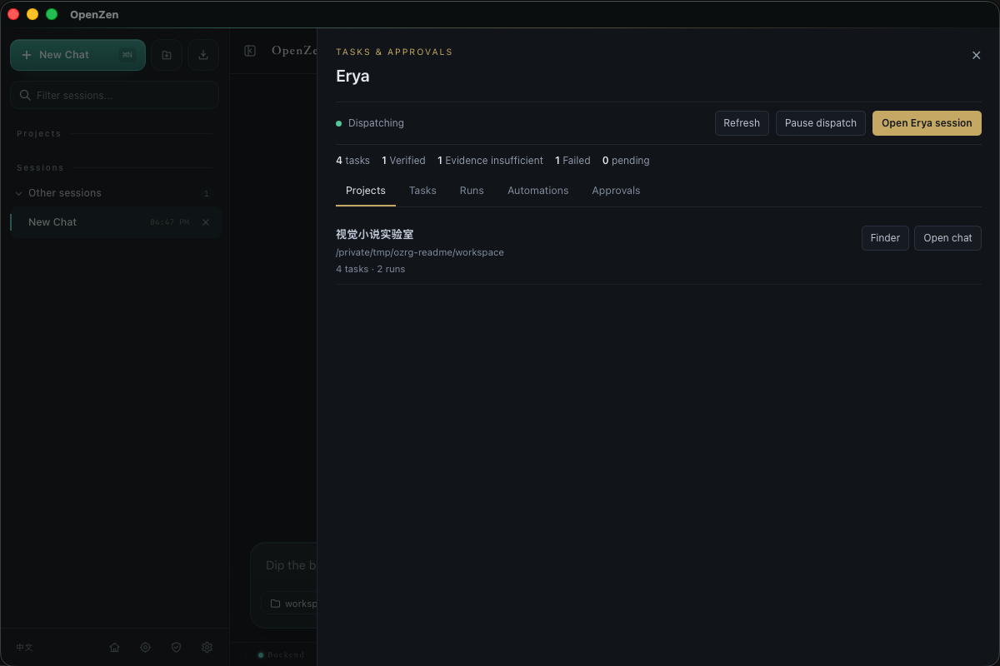
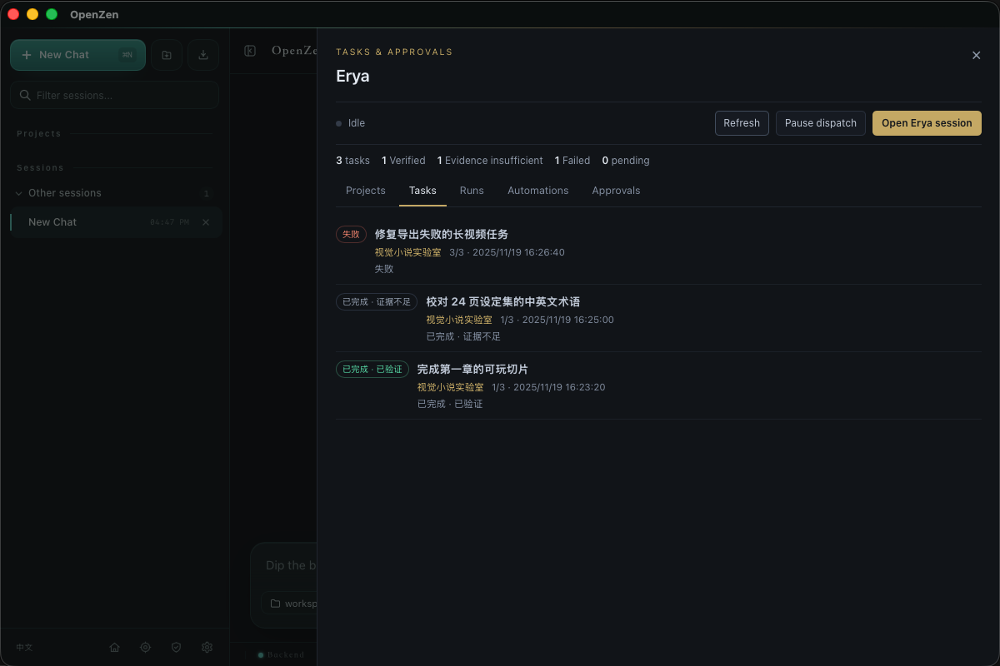
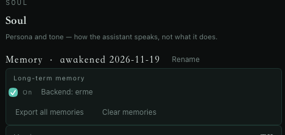

<h1 align="center">OpenZen</h1>

> **一个本地优先的 Agent Harness：让工作不止于一次对话。**
> 一句话交给尔雅，它会拆成一张持久任务图：后台工人执行，验收门禁按真实结果判定，结果写进记忆——模型、文件、权限，都在你的 Mac 上。

[](https://github.com/V1sMu21/OpenZen/releases/latest) [](https://github.com/V1sMu21/OpenZen/actions/workflows/ci.yml)  [](LICENSE)

[English](README.md) · **中文**

<a href="assets/runtime-demo.gif"></a>

*真实桌面运行：一句话 → 计划 → 产物预览 → 可执行验收 → 交付说明。点击图片观看 16 秒循环。*

**⬇️ [下载 macOS 版](https://github.com/V1sMu21/OpenZen/releases/latest)** · [从源码构建](#从源码构建) · [开发指南](docs/development-guide.md)

- 🧭 **控制面，而不是聊天壳。** 尔雅把请求拆成一张持久任务图，派给有边界的后台工人，并把项目、任务、运行、自动化、审批收进同一个控制台。
- ✅ **「完成」是判决，不是声明。** 模型不能给自己的活签字。可执行验收门禁、盲评和 diff 自查共同决定 `verified`、`unverified` 还是 `failed`。
- 🧠 **记忆会复利，而且知道边界。** ERME 维护有上限的灵魂层、崩溃安全的工作缓存、向量索引和带预算的持久层；项目记忆不会串到别的项目。
- 🔒 **本地优先，桌面原生。** 默认情况下，推理、记忆、文件都留在你的机器上。可以接 Apple Silicon 上的 oMLX，也可以在你愿意时接云端端点。无账号、无遥测。
- 🛠 **为真实的模型输出而工程化。** 流式工具调用会被修复，参数会在派发边界归一化，审批决定会被记住，检查点能扛住崩溃。我们把模型输出当作不可信输入——因为它就是。

---

## 目录

- [这是什么](#这是什么)
- [认识尔雅](#认识尔雅)
- [完成是一个判决](#完成是一个判决)
- [会复利的记忆](#会复利的记忆)
- [上下文工具与循环](#上下文工具与循环)
- [权限与安全](#权限与安全)
- [桌面](#桌面)
- [模型与本地推理](#模型与本地推理)
- [架构](#架构)
- [快速开始](#快速开始)
- [扩展](#扩展)
- [状态与边界](#状态与边界)
- [工程](#工程)
- [常见问题](#常见问题)
- [参与贡献](#参与贡献)
- [前人的工作](#前人的工作)
- [许可证](#许可证)

---

## 这是什么

每个 Agent 产品都是两部分：模型和 Harness。模型预测 token；Harness 决定这些 token 能做什么——有哪些工具、上下文留什么、工作怎么拆、结果何时算数、什么会被记住、工具调用畸形时怎么办。

OpenZen 做的是后一半：一个用 Rust 工作区写成、以 macOS 应用交付的 Harness。它只守一条规则：

> **模型提议，Harness 裁决。**

Agent 可以计划、调工具、跑命令、写代码；它不能自己宣布验收通过，不能悄悄扩大权限，也不能忘记项目边界。

Harness 有五件事要做：

1. **让上下文又小又相关**——紧凑的基础提示词、技能的渐进披露、每轮重建的状态块，而不是越滚越长的聊天记录。
2. **把意图变成持久状态**——任务图落在 SQLite 里，而不是只活在模型上下文里。
3. **在明确的权限下并行干活**——后台任务、有边界的工人、会等人的审批。
4. **用环境验收**——真实执行验收命令，不采信自报。
5. **记住发生过什么**——带作用域的记忆、有证据的教训、可回查的运行账本。

> **当前形态：** macOS Apple Silicon 桌面端（Tauri v2 + Svelte 5）。同一套内核也可以作为本地 WebUI 服务（`openzen serve`）运行，供无头机器与远程使用。

---

## 认识尔雅

**尔雅**是常驻 Agent。名字取自中国最早的词典——《尔雅》，一本关于「分辨」的书。它在这里的工作也类似：判断什么算完成、什么不算、什么值得记住。

一个会话可以有两种模式：

| 模式 | 发生什么 | 适合什么 |
|---|---|---|
| **对话** | 你和尔雅在同一轮里工作。它计划、读文件、改代码、直接回答。 | 想清楚一件事、小改动、问答、探索 |
| **派工** | 尔雅把请求拆成一张小的任务图（≤6 项，每项可验收），写进 SQLite，然后把控制权还给你，工人在后台跑。 | 多步骤工作、并行任务、任何超过一轮的事 |

两种模式共享同一套工具与记忆；模型按会话选择，派工时按任务选择。`/erya` 或「交给尔雅」按钮会把当前请求交给派工模式。没有第二个人格。



*尔雅控制台：一个项目、它的任务，以及三种终态并排显示。不用翻对话，就能看出哪些已完成、哪些证据不足、哪些失败。*

### 生命周期

```
你 ──▶ 尔雅 ──▶ 任务图（SQLite）
                  │
        调度器     │ 提升就绪任务、派工
                  ▼
            后台工人 ──▶ 文件、命令、产物
                  │
                  ▼
              验收器 ──▶ verified | unverified | failed
                  │
                  ▼
          运行账本 + 一份 digest ──▶ 你
```

- **调度器是持久的。** 任务、尝试、审批、运行都在 `butler.db` 里。崩溃最多丢掉在途的那一次尝试；任务图、审批和已完成的运行在重启后仍在。
- **工人是有边界的。** 每个工人有自己的会话、工作目录和任务级模型策略。工人不能直接问你；需要决策时把问题交回，由尔雅来问。
- **你拿到的是 digest，不是工人的碎碎念。** 结束时只有一份汇报：完成了什么、哪些未验证、什么被卡住、下一步是什么。
- **每次尝试都可回看。** 控制台保留运行的模型、时长、状态、摘要，以及子会话的完整记录和工具时间线。「14:02 到底发生了什么」是一个查询，不是猜测。

任务图之下，这些原语也可以直接用：后台任务、子代理、目标模式（一个目标、一份预算、一条验收命令），以及可选的 Steward。尔雅负责编排，不替代它们。

### 控制台

**尔雅**面板是应用的操作侧，五个页签：

| 页签 | 看什么 |
|---|---|
| **项目** | 已登记的项目根、任务/运行计数、最近活动、在 Finder 中打开、在此项目开对话 |
| **任务** | 任务图：状态、依赖、尝试次数、假设、所属项目、审批状态 |
| **运行** | 每次派工：模型、时长、状态、摘要，可回放的完整记录与工具时间线 |
| **自动化** | 提醒、目标、Steward 工单、平台桥接——一个注册表，而不是四个面板 |
| **审批** | 等待人决定的不可逆动作，带影响面与可逆性 |

### 上下文有上限

派工会话不会无限膨胀。每一轮带上：

- 从任务图重建的**状态块**（计数、活跃任务、待批、项目）；
- 最近 **30 轮**对话；
- 更早历史的**一行阶段摘要**；需要原文时用 `history_search` 查。

模型看到的是「当前工作的状态」，不是「曾经发生过的一切」。这是 7×24 会话能长期跑下去、而不是越跑越贵的前提。

---

## 完成是一个判决

多数 Agent 在模型说「做完了」时结束任务。OpenZen 在环境同意时结束。

非平凡任务开始前，会先有一份验收契约。普通会话里它是 `task_spec.md`；派工模式里，同样的字段存在任务图的任务上。两种形态都写清交付物和可执行的验收命令：

```markdown
# 普通会话示例；派工模式的验收更严格（见下）
[verify] cargo test --lib
[verify] python3 scripts/check_assets.py --pixels
[verify] python3 scripts/run_sim.py --duration 60
```

没有契约时，Harness 会从任务里合成一份最小契约。普通会话的 `task_spec.md` 里，命令使用策略安全的语法（不允许管道、`&&`、反引号；只允许相对路径）。被策略拒绝的命令记为 **blocked**，不是 failed——它不消耗修复预算。

派工模式更严格。任务图上的显式 `[verify]` / `verify` 命令默认只允许已知测试/构建 runner——`cargo test/check/build`、`npm/pnpm/yarn test/build`、`pytest`、`go test`、`tsc`、`make test`。自定义脚本必须用 `OPENZEN_ALLOW_CUSTOM_VERIFY=1` 显式放行；shell 拼接和重定向一律不接受。

任务有依赖且带显式验收命令时，派工默认 `strict_deps`：下游必须等所有上游任务 `verified` 才启动。`unverified` 的上游不会被悄悄消费；只有明确传 `strict_deps: false` 才回到旧的宽松流程。这是内容链（A → B → C → D）安全的前提：B 不能拿 A 未证实的输出开工。

### 证据栈

1. **硬性门禁（hard gate）**——验收命令，在任务所属项目的根目录执行。
2. **盲评**——一个干净上下文的评审者，只看验收契约和证据，不看工人自己的总结。只有它点名了具体缺陷，才值得再修一轮。
3. **diff 自查**——最终补丁逐文件对照契约再查一遍。
4. **交付说明**——怎么验证的、还剩什么没闭环。桌面端会把这段从回复正文里折出去，复制答案时不会带上报告尾巴。

### 三种终态

| 状态 | 含义 | 桌面显示 |
|---|---|---|
| `verified` | 所有硬性门禁通过、至少一条强门禁通过、评审没有点名缺陷、没有悬而未决的门禁。 | 已完成 · 已验证 |
| `unverified` | 活干完了，但证据证明不了。诚实、终态，绝不悄悄升级成「已完成」。 | 已完成 · 证据不足 |
| `failed` | 硬性门禁失败。运行是红的，证据说明为什么。 | 失败 |

派工模式下，验收器是唯一能写终态的成分。尔雅可以转述判决，但不能创造判决。这比「自报完成」慢；这是演示和交付的区别。



*`已验证`、`未验证`（证据不足）、`失败` 是三个独立的终态。徽章由验收器写入，不是模型自己写的。*

---

## 会复利的记忆

**ERME** 是自研记忆引擎。它不是给聊天记录外挂一个向量库，而是一个有写入策略的分层存储。



*记忆的控制面：长期记忆已开启、后端是 ERME，导出和清空都不需要手动改文件。*

| 层 | 存什么 | 为什么要有 |
|---|---|---|
| **L0 · 灵魂** | 画像、生活叙事、反思、空闲联想 | 跨会话的连续性；以有上限的前缀注入，不是整段倾倒 |
| **L1 · 工作缓存** | 热事实与近期状态，带 WAL | 崩溃安全，纳秒级读取 |
| **L2 · 向量** | HNSW 索引 + 词法/向量混合召回 | 语义检索，但不离开本机 |
| **L3 · 持久** | 压缩后的长期存储，带预算 | 有界增长：日上限、按重要性淘汰、去重、衰减 |

### 作用域、质量、预算

- **每条记忆都带作用域**——`project:<id>`、`workspace:<hash>` 或 `legacy`。项目召回不会静默回退到全局池；一个项目的记忆留在那个项目里。
- **写入要过质量门。** 低置信度的陈述会被拒绝或进隔离区；一个坏猜想不会变成永久事实。灵魂前缀被压到几百字符以内，只注入高置信、可读的事实。
- **密钥先脱敏再落盘**——API key、bearer token、云凭据、私钥。
- **增长有预算。** 助手常驻，不等于存储可以无限长。

### 复利回路

- **检查点**让会话在重启后从中间继续，并带上 git 上下文。
- **Harness 账本**记录可复用的教训，但必须有可验证证据，并支持快照回滚。
- **反思**（`reflections.jsonl`）把成功和失败沉淀成未来会话能读的文字。
- **质量失败**会变成账本条目，后续会话自动避开。

常驻助手应该越用越懂你的工作，而不只是越用越长。前提是记忆有作用域、有审计、有预算。

---

## 上下文工具与循环

### 上下文

基础系统提示词**不到 4 KB**（中文 3.4 KB / 英文 3.8 KB）。技能和 SOP 渐进披露：需要时再搜索、再加载，而不是每一轮都塞进去。普通会话在接近模型上下文窗口时压缩；派工会话用上面的「状态块 + 阶段摘要」策略。

工具 schema 排序固定，提示词前缀保持字节稳定，工具列表顺序确定——这样服务端的提示词缓存才真的能命中。对本地模型，这不是省钱，而是「一轮响应」和「每轮重新 prefill」的区别。

### 工具

**40+ 内置工具**覆盖文件、Shell、搜索、浏览器、电脑操作、定时、任务与记忆。MCP 服务器可以再加工具，技能可以再加打法。重要的不是数量：

- **一个派发边界。** 所有工具调用都经过 `ToolRegistry::dispatch`，参数在那里按工具 schema 归一化。模型把 `code` 写成 `cmd`、或者拿工具名当 key，调用仍然能执行。
- **能并行就并行。** 独立的读取和探测并发执行；控制类工具（`ask_user`、`submit_plan`）绕过队列，不会排在一次长构建后面。
- **取消会传播。** 停父会话会停子会话；停子会话不会误杀父会话。
- **后台任务是原生的。** 长命令和子代理是可跟踪的后台任务，有输出、状态和终止开关，而不是把对话卡住。

### 可靠性

真实的网关和本地模型会产出畸形的工具调用。OpenZen 在流边界就修：

- DSML 参数泄漏、半转换的工具调用碎片；
- 截断的闭合标签（`</` 而不是 `</parameter>`）和调用尾部残留标签；
- 错误的参数名、双重编码的参数、没有名字的参数；
- 一段能正常解析、但把下一个参数吞进值的 JSON。

回归测试的样本是失败会话里的原始字节。解析器不是「但愿没事」；它对真实跑挂过的形状有测试。

长时间的沉默被当作慢，而不是死：云端网关的 SSE 空闲容忍 180 秒，本地服务 300 秒，再重试，因为本地模型可能只是在想。检查点和重试让长跑活下来；循环熔断阻止重复的相同调用。目标是无聊的可靠，不是完美的演示。

---

## 权限与安全

本地不等于可信。模型输出是不可信输入，安全层在派发时生效，而不是在提示词里祈祷。

| 边界 | 行为 |
|---|---|
| **工作区** | 写操作留在工作目录内。写到工作区外需要明确审批，审批会按路径记在这个会话里。 |
| **Shell** | 命令按 pattern 审批。「始终信任」记住的是一条具体命令形状，不是「全部放行」。 |
| **工人** | 工人的写工具拒绝项目外路径。macOS 上它的 Shell 跑在 `sandbox-exec` 写入沙箱里：项目根、临时目录、构建缓存可写。 |
| **不可逆任务** | 派工模式下，任务分为只读、可逆、不可逆。不可逆任务停在审批队列，不会硬闯。 |
| **密钥** | 凭据在你的配置里，不在提示词里。记忆落盘前会脱敏常见 key 模式。 |
| **审计** | 审批、拒绝、工具调用都有日志；运行账本记录发生了什么、用的哪个模型。 |

**审批会等人。** 当前默认最长 30 分钟，有倒计时；你离开时会发系统通知；看门狗不会把你的「不在」误判成坏请求。拒绝会被记住，同一个问题不会问第二遍。**完全访问**是给无人值守准备的一个模式，不是默认值。

**Steward（可选）。** 每一步都可以写进本地 SQLite 飞行记录仪。确定性检测器会在任何模型介入之前发现卡住的工单、重复的工具调用、越界写入、预算超支、没有证据的「完成」；纠正引擎可以提醒工人，或回滚某一步改过的文件。监督和推理一样，留在本地。

---

## 桌面

桌面不是「终端加一个输入框」。它是按 Agent 工作的形状做的：长、并行、产物多。

- **产物面板**——HTML、Markdown、图片、PDF、Word/Excel/PowerPoint、表格、代码、diff、终端输出。窗口够宽就并排，不够宽就浮在对话上。
- **流式时间线**——思考块、工具卡、改动文件摘要会自动折叠。长会话的 DOM 数量保持常量，而不是堆一座滚动条纪念碑。
- **工作可见**——输入框旁的后台任务 / 子代理条、上方的任务胶囊、带影响面与可逆性的审批卡、可折叠的交付说明。
- **尔雅控制台**——项目、任务、运行、自动化、审批；项目卡可以直接在该项目根下开一个对话。
- **设置**——模型、服务商、技能、MCP、灵魂状态、token 用量、更新。界面中英双语。
- **设计语言，不是皮肤**——宋韵天青「器物语法」：三色、釉面、宋体做结构、楷体写思考。规则在 [frontends/DESIGN.md](frontends/DESIGN.md)。

**其他形态。** 同一套内核也可以 `openzen serve`（本地 WebUI）运行。微信、飞书、Telegram 桥接让同一个助手出现在你日常聊天的地方，共享同一套内核与数据根。

---

## 模型与本地推理

OpenZen 是**本地优先，不是只许本地**。它支持 OpenAI 兼容的 chat completions。你可以登记任意多个具名模型，按会话选择，并按模型设置推理强度。

| 后端 | 常见端点 | 说明 |
|---|---|---|
| **oMLX**（参考） | `http://127.0.0.1:8000/v1` | Apple Silicon 上的 MLX；可常驻多个长上下文模型 |
| **云端 API** | 你的服务商 | 可选；数据只去你配置的端点 |

**本地模型建议。** oMLX 上值得试的几个起点（不是背书）：`qwen3.8-27b`、`qwen3.8-flash-next`、`glm5.3-flash`、`Sage-A1.5`、`Occamy-1.0`。按你的内存和上下文需求选择。

**硬件。** 桌面端需要 Apple Silicon。16 GB 足以在实用上下文长度下跑 7–14B；64 GB 以上才能发挥这套 Harness 面向的长上下文模型。256 GB 统一内存是甜点，不是门槛。

**隐私。** 运行数据在 `~/.openzen/` 下——workspace、记忆、Harness 账本、日志、会话、管家数据库。没有账号，没有遥测。用本地模型和本地工具时可以离线；联网搜索、浏览器和云端模型需要你给它们网络。

---

## 架构

```
┌─────────────────────────────────────────────────────────────┐
│ macOS 应用 · Tauri v2 + Svelte 5                            │
│  对话 · 产物面板 · 尔雅控制台 · 审批 · 设置                  │
└───────────────┬─────────────────────────────────────────────┘
                │ Tauri commands / SSE
┌───────────────▼─────────────────────────────────────────────┐
│ oz-core        循环 · 上下文 · 检查点 · 质量门               │
│ oz-tools       40+ 工具 · MCP · 技能 · 浏览器                │
│ oz-llm         OpenAI 兼容 · 流式                            │
│ oz-memory      ERME L0–L3 · 作用域召回 · 预算                │
│ oz-steward     任务图 · 验收器 · 目标 · 飞行记录仪           │
│ oz-safety      审批 · 信任库 · 边界                          │
└───────────────┬─────────────────────────────────────────────┘
                │
┌───────────────▼─────────────────────────────────────────────┐
│ 本地模型服务（oMLX）                                        │
│ 或你配置的云端端点                                          │
└─────────────────────────────────────────────────────────────┘
```

| 层 | crate | 职责 |
|---|---|---|
| **内核** | `oz-core`、`oz-core-types` | Agent 循环、上下文与压缩、检查点、质量门、后台任务、子代理 |
| **模型** | `oz-llm` | OpenAI 兼容客户端、流式、重试、路由 |
| **工具** | `oz-tools`、`oz-mcp`、`oz-skill-mcp`、`oz-browser` | 工具注册表、MCP 桥、技能库、浏览器与电脑操作 |
| **状态** | `oz-memory`、`oz-steward` | ERME 记忆、任务图、验收器、目标、飞行记录仪、回滚 |
| **安全** | `oz-safety` | 权限管道、信任库、工作区与路径边界 |
| **界面** | `src-tauri`、`frontends`、`oz-server`、`oz-platform-*` | 桌面端、WebUI、消息平台桥 |
| **运维** | `oz-config`、`oz-scheduler`、`oz-reflect`、`oz-plugin`、`oz-import`、`oz-tests` | 配置、调度、反思、插件、会话导入、测试设施 |

23 个 `oz-*` crate 加 Tauri 壳，组成一个 Cargo workspace。前端是 Svelte 5 + 自定义 `@theme` token 体系，不是组件库拼装。

---

## 快速开始

### 1. 安装应用

下载最新 [dmg](https://github.com/V1sMu21/OpenZen/releases/latest)，打开后把 **OpenZen** 拖进 Applications。构建是 ad-hoc 签名、未做公证，首次启动 macOS 可能要求确认（系统设置 → 隐私与安全性 → 仍要打开）。

### 2. 准备模型

启动 Apple Silicon 上的 oMLX，地址 `http://127.0.0.1:8000/v1`。这是受支持的本地运行时；云端 OpenAI 兼容端点可选。

```bash
# 自检：你的服务应该能回答这个
# （返回 401 要求 API key，也是一个健康的回答）
curl http://127.0.0.1:8000/v1/models
```

### 3. 指向它

打开 **设置 → 模型**，添加一个具名条目（端点 + 模型 id），设为默认。凭据存在本地。首次启动会创建 `~/.openzen/`。

### 4. 给它真活

要一个多步骤的任务——「做一个落地页并在浏览器里验收」「修掉失败的测试并给我看 diff」「调研这个市场并产出一份报告」。长任务交给尔雅，然后去忙别的；任务图会继续跑。

### 从源码构建

需要：macOS + Command Line Tools（提供 `clang` 和链接器；不需要完整 Xcode）、Rust（版本由 `rust-toolchain.toml` 固定）、Node.js 20+、Tauri v2 CLI。

```bash
git clone https://github.com/V1sMu21/OpenZen.git
cd OpenZen

# 只需一次
cargo install tauri-cli --version "^2" --locked

npm --prefix frontends ci
cargo tauri build --bundles app
# → target/release/bundle/macos/OpenZen.app
```

开发模式：

```bash
cargo tauri dev
# 或者把运行数据与真实安装隔离：
OPENZEN_DATA_DIR=/private/tmp/openzen-dev cargo tauri dev
```

### WebUI

```bash
npm --prefix frontends run build
cargo run -- serve --port 18567
```

`OPENZEN_DATA_DIR` 会整体搬走数据根（workspace、记忆、会话、日志），适合开发。默认是 `~/.openzen/`。

---

## 扩展

- **工具。** 在 `oz-tools` 里实现 `ToolHandler` 并注册进 `ToolRegistry`；或者用 MCP 服务器加工具，不用改 Rust。
- **技能。** 一个技能就是带 frontmatter 的 `SKILL.md`。技能会被索引、搜索、按需加载——渐进披露，不是提示词倾倒。
- **MCP。** 在设置里加 stdio MCP 服务器；它们的工具进入同一个注册表，走同一条审批管道。
- **平台。** `oz-platform-wechat`、`oz-platform-feishu`、`oz-platform-telegram` 把同一套内核接到消息平台。
- **界面。** Svelte 5 组件和 token 在 `frontends/`；改视觉语言前先读 `frontends/DESIGN.md`。
- **文档。** 从 [docs/development-guide.md](docs/development-guide.md) 开始，再看 `docs/` 下的设计记录。

---

## 状态与边界

**Pre-1.0，活跃开发中。** 最新 tag 是 **v0.2.6**（2026-11）。本文描述的控制面在 `main` 上，随下一个版本发布；想现在用就从源码构建。

**已经能用**

- 尔雅派工模式：任务图、调度器、后台工人、验收器终态、digest。
- 项目控制台：项目、任务、运行、自动化、审批；运行记录与工具时间线。
- 项目级执行边界：任务级项目绑定、工人文件隔离、macOS Shell 写入沙箱。
- ERME：作用域召回、质量门写入、灵魂注入上限、WAL 压缩、去重/衰减、密钥脱敏。
- 会等人的审批：默认 30 分钟、系统通知、墙钟倒计时、拒绝记忆。
- 流式修复：参数归一化、DSML 泄漏恢复、截断闭合标签、尾部调用标签。
- 1,600+ workspace 测试；ERME crate 另有独立测试。

**已知边界**

- 桌面端只支持 macOS Apple Silicon。内核与服务端不依赖桌面壳，但其他桌面目标尚未支持。
- 本地模型弱，计划就弱。Harness 可以拒绝坏活，但不能凭空创造能力。
- 验收能证明多少，取决于门禁能测出什么。显式 `[verify]` 命令可以让内容任务变成 `verified`；没有强证据时结果就是 `unverified`——这是设计，不是 bug。自定义验收脚本需要 `OPENZEN_ALLOW_CUSTOM_VERIFY=1`。
- 这不是虚拟机。审批和沙箱降低风险，但不能让不可信代码变安全。
- 桌面是主形态。WebUI 对无头机器有用，但没有控制台和产物面板。

---

## 工程

这个项目用它交付 Harness 的方式开发：先过门，再谈结论。

```bash
# 后端
cargo test --workspace -- --test-threads=1
cargo clippy --workspace --all-targets

# 机械闸门（事件两端、i18n、未定义 CSS 变量、默认值、安全边界）
bash scripts/verify_gates.sh --base HEAD

# 复杂场景套件（release-gate R2.5）
cargo test -p oz-steward --test scenario_suite -- --test-threads=1
cargo test -p oz-steward --test goal_fault_injection -- --test-threads=1
cargo test -p oz-steward --test steward_fault_injection -- --test-threads=1
python3 scripts/scenarios/check.py

# 前端
npm --prefix frontends run check
npm --prefix frontends run build
```

- **回归测试来自真实失败。** 流式解析器的测试回放畸形网关响应的原始字节；检查点测试在可用时使用真实会话数据。
- **一个修复，先有一条会红的测试。** 确实无法自动测的，明确标注并给出人工验证路径。
- **发布是推导出来的。** [Conventional Commits](https://www.conventionalcommits.org/) → `git-cliff` → `scripts/release.sh` → tag。发布门会跑完整测试、在 macOS 上构建 dmg，并挂到 GitHub Release。
- **按整个 workspace 检查。** 单 crate 测试不够；一个改动可以在这个 crate 编译通过，却把二进制弄挂。
- **复杂场景是门，不是演示。** 34 条可执行场景覆盖内容依赖链、失败阻断、重启恢复、审批、并发、项目边界、取消、工人超时、子代理取消和压缩召回。`scripts/scenarios/check.py` 是棘轮：删场景会让 release gate 变红。

---

## 常见问题

**一定要 256 GB 的 Mac 吗？**
不用。16 GB 足以在实用上下文长度下跑 7–14B。统一内存的意义在长上下文模型，以及让模型、向量索引、浏览器待在同一块内存池里。

**可以用云端模型吗？**
可以。任意 OpenAI 兼容端点都能作为一个具名模型。本地是默认姿态，不是限制。

**数据会离开本机吗？**
只会去你配置的端点——本地模型服务、你添加的云端模型、或你主动调用的联网工具。没有账号、没有遥测、没有托管控制面。

**能离线用吗？**
本地模型 + 本地工具时可以。联网搜索、浏览器自动化、云端模型需要你给它们网络。

**「完成」是谁定的？**
验收器，根据验收证据定。模型可以提议完成，但不能写 `verified`。证据不足时，任务以 `unverified` 结束。

**有 Linux / Windows 桌面版吗？**
目前没有。Rust 内核和服务端不依赖桌面壳；桌面壳和 macOS 集成尚未支持其他平台。

---

## 参与贡献

欢迎 issue 和 PR。非平凡改动请按这个顺序：

1. 先读 [AGENTS.md](AGENTS.md) 和 [docs/development-guide.md](docs/development-guide.md)。
2. 控制改动范围。修 bug 不要夹带重构。
3. 加一条修复前会失败的回归测试。
4. 跑上面的闸门，包括 workspace 全量检查。
5. 用 Conventional Commit（`fix(llm): …`、`feat(butler): …`）。版本是从提交推导的。

如果你改的是系统提示词、流式解析器或安全边界，请用你正在保护的那个真实形状写测试。这些地方「我机器上是好的」不够。

如果 OpenZen 在你的 Mac 上留了下来，一颗 star 能帮别人找到它。

---

## 前人的工作

OpenZen 最初是 Python **GenericAgent** 框架的 Rust 重写，后来完全分叉。它也受益于开源 Harness 社区的公开经验——system reminder、渐进披露的技能、diff 自查、飞行记录仪，以及「把提示词当代码」的纪律。感谢开源 Harness 社区。

---

## 许可证

[MIT](LICENSE) © 2026 OpenZen contributors
